# MANUAL ADMIN ORGANISASI — myWAP

> **Untuk:** Admin Organisasi (role `Admin` / `org-admin`)
> **Platform:** Web Panel (browser — PC / laptop)
> **Versi:** 1.0
> **Nota:** Manual ni untuk admin organisasi sahaja. Ahli biasa ada manual sendiri (`Manual-Pengguna.md`). Fungsi khas **Superadmin** tak dimasukkan di sini.

---

## Cara Guna Manual Ini

- Semua fungsi dalam manual ni dibuat melalui **Web Panel** — buka guna browser di PC atau laptop. App mobile tak diperlukan.
- Login guna akaun yang sama dengan app myWAP. Menu penuh ada di **sidebar kiri**.
- Setiap bahagian disusun ikut menu sidebar: **Buka** → **Langkah** → **Gambar**.
- Fungsi bertanda *(Superadmin)* hanya boleh dibuat oleh akaun Superadmin. Kalau anda Admin biasa, butang tu tak akan muncul.

---

## Kandungan

1. [Peranan & Skop Admin Organisasi](#1-peranan--skop-admin-organisasi)
2. [Log Masuk & Akses Panel](#2-log-masuk--akses-panel)
3. [Pengurusan Ahli](#3-pengurusan-ahli)
4. [Yuran Ahli](#4-yuran-ahli)
5. [Kehadiran Program](#5-kehadiran-program)
6. [Siaran & Hebahan](#6-siaran--hebahan)
7. [Program & Acara](#7-program--acara)
8. [Kempen](#8-kempen)
9. [Info Terkini / Berita](#9-info-terkini--berita)
10. [Artikel](#10-artikel)
11. [Video](#11-video)
12. [Popup](#12-popup)
13. [Infaq](#13-infaq)
14. [Penderma](#14-penderma)
15. [Borang (Form Builder)](#15-borang-form-builder)
16. [Undian & Tinjauan](#16-undian--tinjauan)
17. [Kemudahan & Tempahan](#17-kemudahan--tempahan)
18. [Usrah](#18-usrah)
19. [Cawangan](#19-cawangan)
20. [Jawatan](#20-jawatan)
21. [Pertukaran Cawangan](#21-pertukaran-cawangan)
22. [Kewangan](#22-kewangan)
23. [E-Dagang: Produk, Kategori, Pesanan](#23-e-dagang-produk-kategori-pesanan)
24. [Direktori](#24-direktori)
25. [Info Organisasi & Carta](#25-info-organisasi--carta)
26. [Export Data](#26-export-data)
27. [Soalan Lazim (FAQ)](#27-soalan-lazim-faq)

---

## 1. Peranan & Skop Admin Organisasi

Sebagai **Admin Organisasi**, anda uruskan ahli dan operasi organisasi sendiri sahaja. Semua data **terhad pada organisasi anda** (`current_organization_id`). Anda **tak boleh**:

- Lihat data organisasi lain.
- Ubah tetapan peringkat platform — itu kerja Superadmin.
- Hantar siaran ke seluruh platform. Audiens `Semua` akan terhad pada ahli organisasi anda.

Yang anda boleh urus:

- **Ahli** — lihat, aktif/deactivate, kemas kini profil, tukar role.
- **Yuran** — generate, kutip, reconcile, import, export.
- **Program** — program/acara, borang pendaftaran, peserta, kehadiran.
- **Content** — Info Terkini, artikel, video, popup, pengumuman, pustaka.
- **Fasiliti** — kemudahan dan tempahan.
- **Lain-lain** — undian, usrah, borang, infaq, penderma.
- **Organisasi** — cawangan, jawatan, direktori, carta organisasi, e-dagang.

---

## 2. Log Masuk & Akses Panel

1. Buka browser (PC/laptop) dan pergi ke laman web rasmi myWAP.
2. Log masuk guna emel/IC dan kata laluan yang sama dengan app myWAP.
3. Anda terus masuk ke **Papan Pemuka Admin**. Menu penuh ada di **sidebar kiri**.

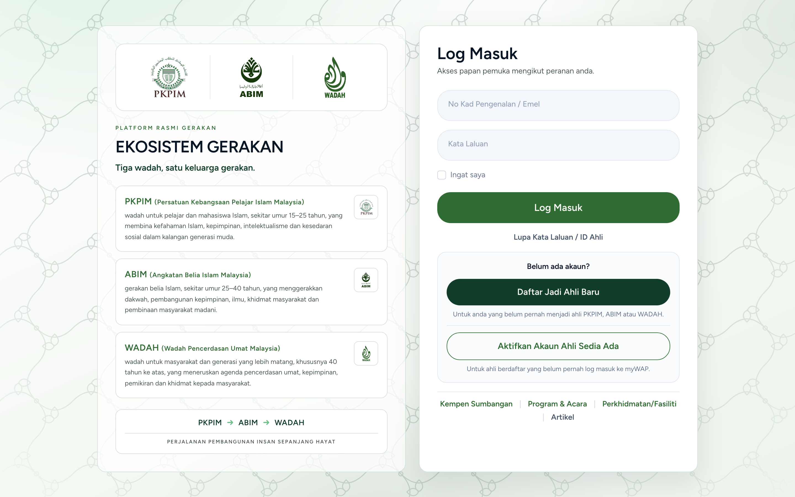

**Nota:** Ada fungsi yang hanya ada di web, contohnya cipta program dan urus yuran.

---

## 3. Pengurusan Ahli

**Buka:** Sidebar → **Ahli**

**Boleh buat:**

- Lihat statistik: `Jumlah Ahli`, `Ahli Aktif`, `Tidak Aktif`.
- Search & filter penuh — organisasi, role (`Admin`/`Member`), status akaun, negeri, cawangan, status yuran, susunan dan julat tarikh daftar.
- **Tukar role ahli** guna menu `Peranan` (Ahli / Admin / Admin Cawangan). Terus berkuat kuasa.
- **Aktif / deactivate** akaun ahli.
- **Buang ke Tong Sampah** (soft delete) dan **Restore**.
- **Lihat Kad Ahli**.
- **Profil Ahli** (panel sisi) — tab `Peribadi`, `Kerjaya`, `Alamat`, `Lain`, `Aktiviti`.
- **Edit Profil Ahli** — kemas kini maklumat asas, kerjaya, alamat, kecemasan, dan tetapan visibility dalam direktori (nak muncul ke tak).

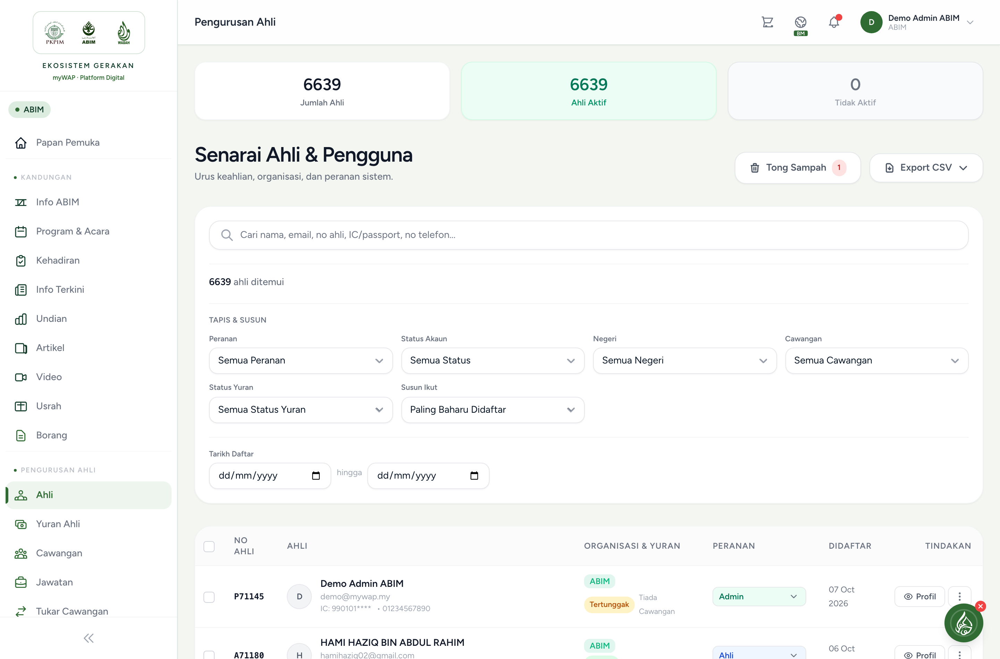

**Penting:** Anda boleh tukar role antara `Ahli` ↔ `Admin` ↔ `Admin Cawangan`, tapi **tak boleh** bagi role `Superadmin`. Tindakan sensitif — tambah ahli, padam kekal, restore, import, reset kata laluan, update IC — dibenarkan **untuk ahli organisasi anda sendiri**. Pindah ahli ke organisasi lain kekal **Superadmin sahaja**.

---

## 4. Yuran Ahli

**Buka:** Sidebar → **Yuran Ahli**

**Boleh buat:**

- Kad statistik: `Jumlah Ahli`, `Selesai`, `Tertunggak`, `Seumur Hidup`, `Dikecualikan`, `Dikutip`.
- Carta `Kutipan Bulanan`.
- **Jana Yuran** — generate rekod yuran untuk tahun yang dipilih.
- **Bayaran Manual** (`+ Manual`) — rekod bayaran: `ID Ahli`, `Tahun`, `Jumlah`, `Rujukan`, `Bukti Pembayaran`.
- **Import CSV** — upload fail CSV yuran, tengok `Preview`, lepas tu `Proses`.
- **Export** — CSV / Excel / PDF.
- **Profil Kewangan** (panel sisi) — `Ringkasan`, `Sejarah Pembayaran`, `Log Aktiviti`. Boleh edit jumlah/tarikh/catatan, batalkan bayaran (`Batalkan`), dan download resit.
- **Yuran Seumur Hidup** dan **Pengecualian Yuran** — kena bagi sebab.
- **Laporan Rekonsiliasi** — `Sasaran Kutipan`, `Terkumpul`, `Tertunggak`, `Kadar Kutipan`.

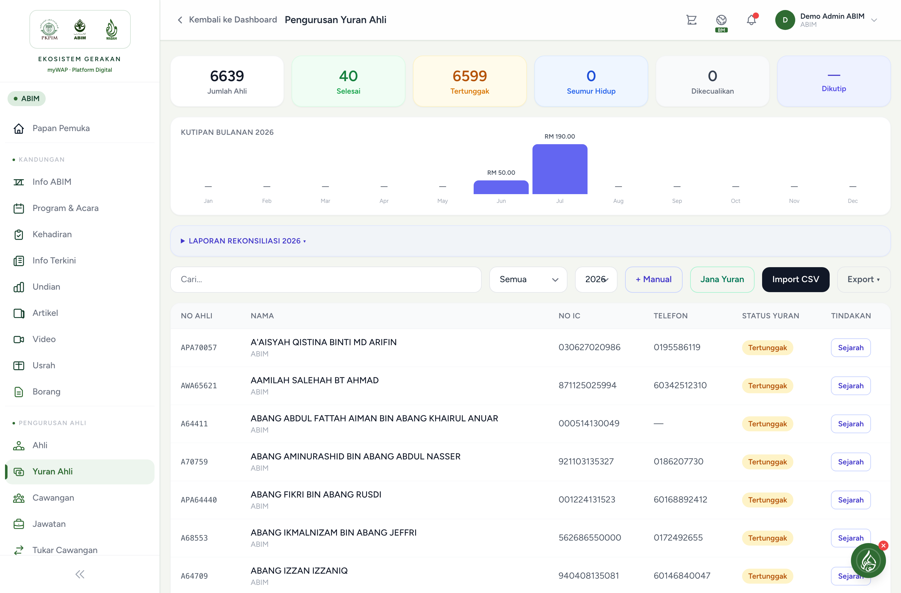

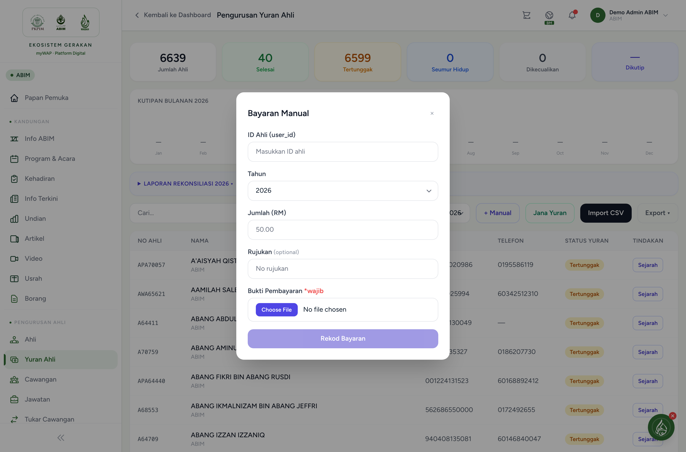

---

## 5. Kehadiran Program

**Buka:** Sidebar → **Kehadiran**

**Boleh buat:**

- Kad statistik: `Jumlah Daftar`, `Hadir`, `Bayaran Menunggu`.
- Kad program dengan kadar kehadiran (%), `Lihat Peserta`, `QR`, `Urus`.
- Jadual peserta dengan status bayaran dan kehadiran.
- **Export Excel** dan **Export PDF**.

**Tip:** Untuk rekod kehadiran walk-in, tekan `QR` pada kad program — sama seperti imbas QR dalam app.

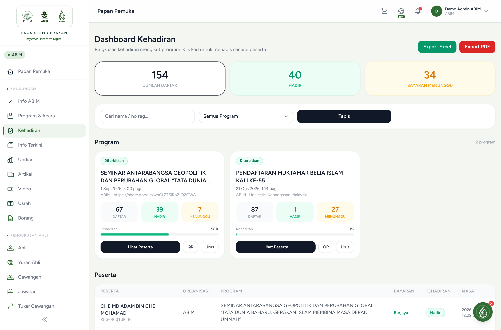

---

## 6. Siaran & Hebahan

**Buka:** Sidebar → **Push Notification** dan **Pengumuman**

**Tab Push Notification**

- `Tajuk Notifikasi`, `Kandungan / Mesej`, `Kumpulan Sasar` (`Semua Ahli`, `Ahli Organisasi Sahaja`, `Individu Tertentu`), `Saluran Penghantaran` (`In-App`, `Email`), `Format Emel`.
- Sejarah penghantaran dengan status dan log.

**Tab Papan Pengumuman**

- `Tajuk Pengumuman`, `Kandungan`, `Gambar Cover`, `Galeri Gambar`, `Kumpulan Sasaran` (`Kesemua Ahli`, `Ahli Tunggakan Yuran`, `Kumpulan Usrah Spesifik`), `Tarikh Terbit`, `Pin` (utamakan).
- Senarai pengumuman boleh edit/padam.

**Nota:** Untuk admin organisasi, khalayak `Semua` terhad pada ahli organisasi anda sahaja.

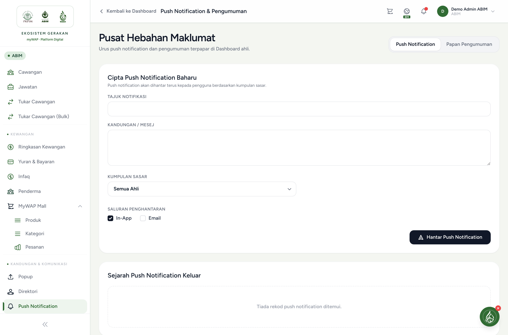

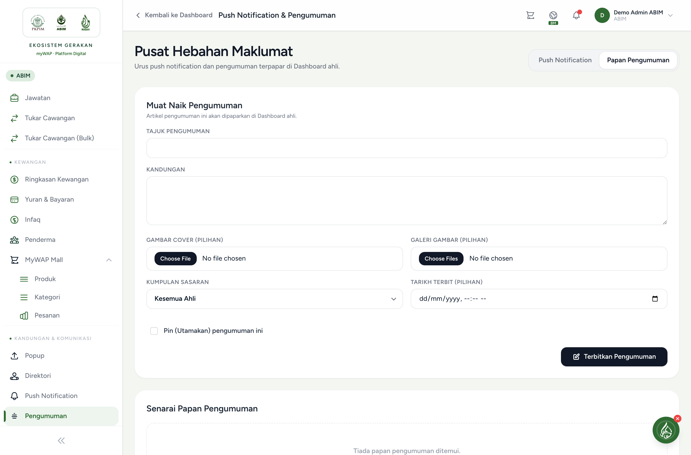

---

## 7. Program & Acara

**Buka:** Sidebar → **Program & Acara**

### 7.1 Senarai Program

- Search dan filter program.
- Setiap kad tunjuk: status (`draft`/`published`/`closed`), kategori, tarikh, organisasi, bilangan pendaftaran.
- Tindakan: `Borang (N)`, `Urus`, `Edit`, `Lihat`, `Kongsi`, `Padam`.

### 7.2 Cipta / Edit Program

1. Isi `Tajuk`, `Penerangan`, `Kategori`, `Status`, `Jenis` (`Fizikal`/`Dalam Talian`), `Lokasi / Pautan`, `Mula`, `Tamat`, `Organisasi Terlibat`, `Poster Program` (1080×1350).
2. Tekan **Cipta Program** atau **Kemas Kini Program**.

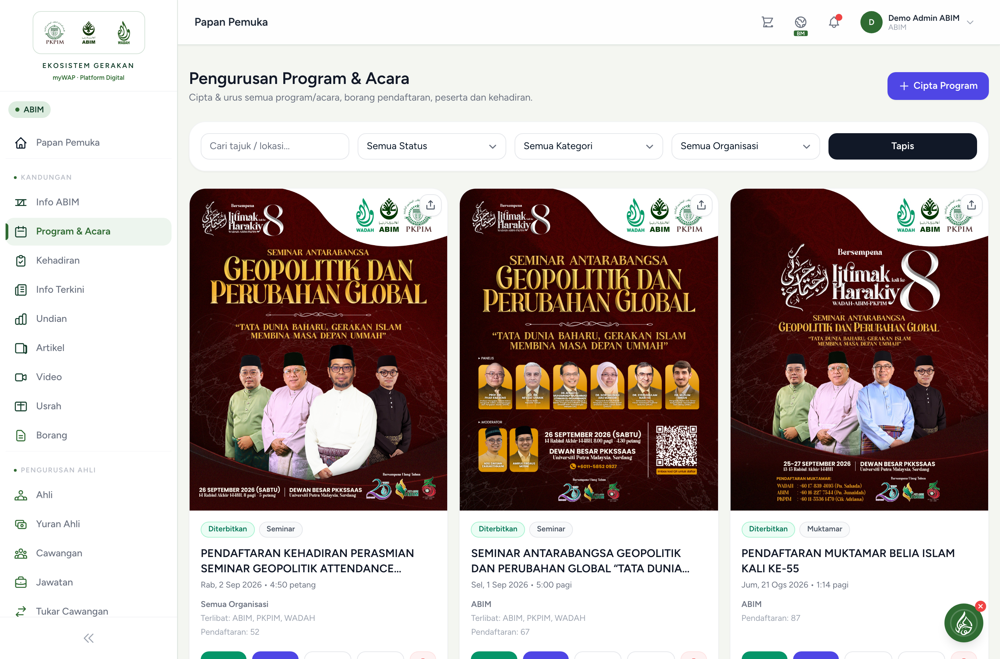

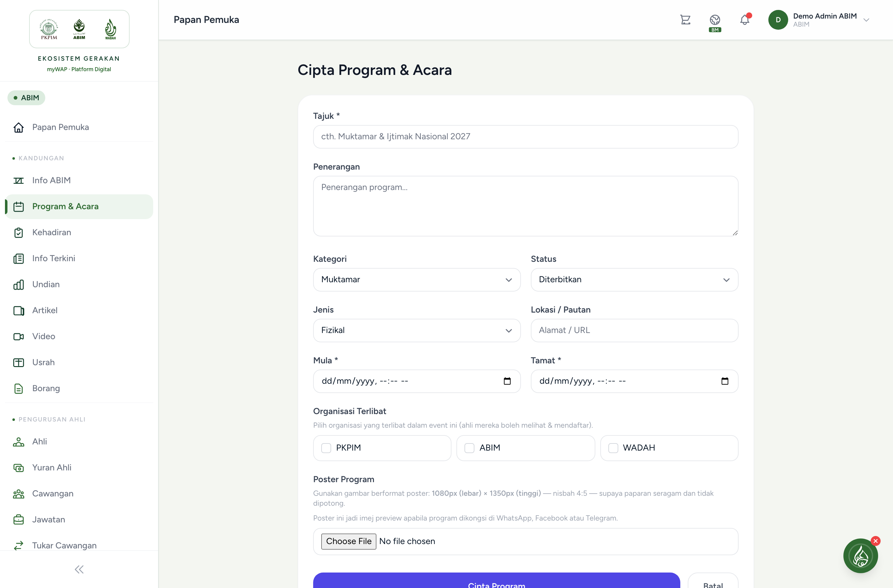

### 7.3 Borang Pendaftaran & QR

- Cipta/edit borang pendaftaran.
- Guna `Kongsi` untuk dapatkan QR + pautan, atau `Pratonton` untuk semak dulu.

### 7.4 Peserta (Registrations)

- Statistik `Jumlah`, `Disahkan`, `Menunggu`.
- Jadual peserta. Tukar status: `Disahkan`, `Menunggu`, `Dibatalkan`.

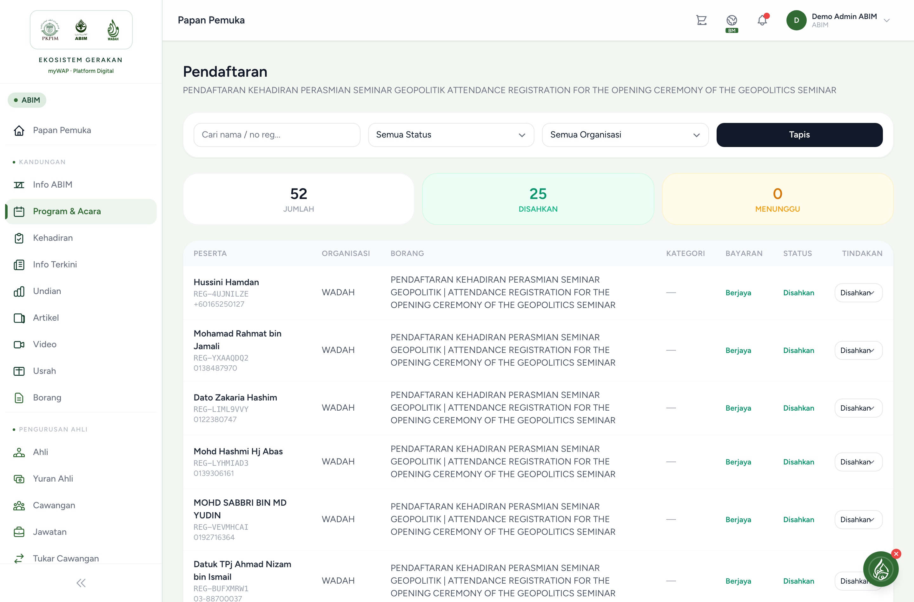

---

## 8. Kempen

**Buka:** **Papan Pemuka** → bahagian **Cipta Kempen**

1. Isi `Tajuk`, `Jumlah Sasaran`, `Penerangan`, `Status` (`Draf`/`Aktif`/`Tutup`).
2. Tekan **Simpan Kempen**.

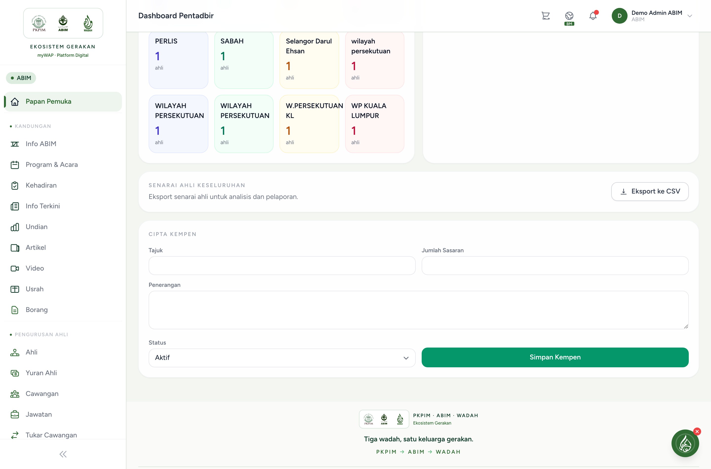

---

## 9. Info Terkini / Berita

**Buka:** Sidebar → **Info Terkini**

1. Tambah kategori (nama, ikon) kalau perlu.
2. Cipta info: `Target Organisasi`, `Kategori`, `Tajuk`, `Ringkasan`, `Kandungan`, `Cover Image`, `Terbitkan sekarang`.
3. Tekan **Simpan Info**.
4. Senarai info boleh `Edit` / `Delete`.

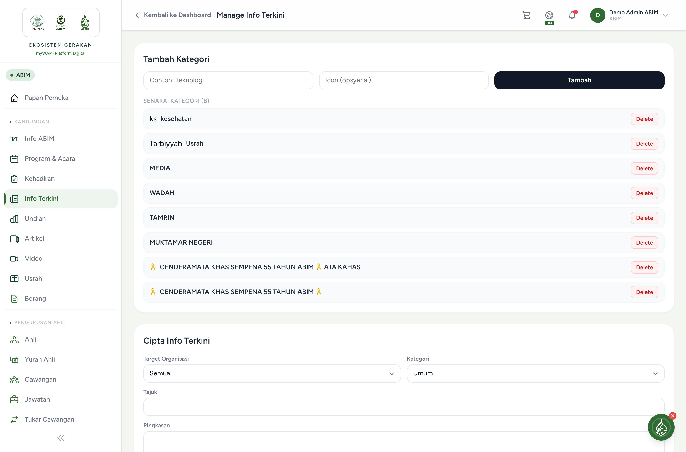

---

## 10. Artikel

**Buka:** Sidebar → **Artikel**

1. Tekan **+ Tulis Artikel**.
2. Isi `Maklumat Artikel` (Target Organisasi, Tajuk, Ringkasan, Kandungan).
3. Isi `Media` (Cover, Galeri) dan `Kategori & Tag`.
4. Tetapkan `Penerbitan` (`Terbitkan sekarang`, `Featured`).
5. Tekan **Simpan Artikel**.

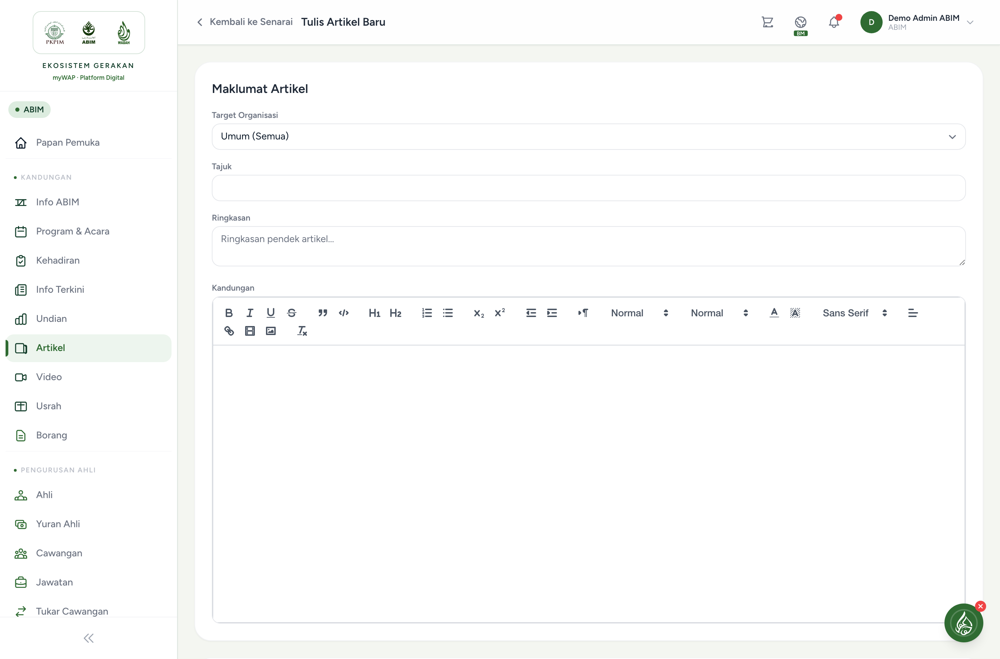

---

## 11. Video

**Buka:** Sidebar → **Video**

1. Tekan **Tambah Video**.
2. Isi `Organisasi` (kosongkan untuk global), `Tajuk`, `Link YouTube`.
3. Tanda **Sedang Langsung (LIVE)** kalau perlu.
4. Tekan **Simpan Video**.

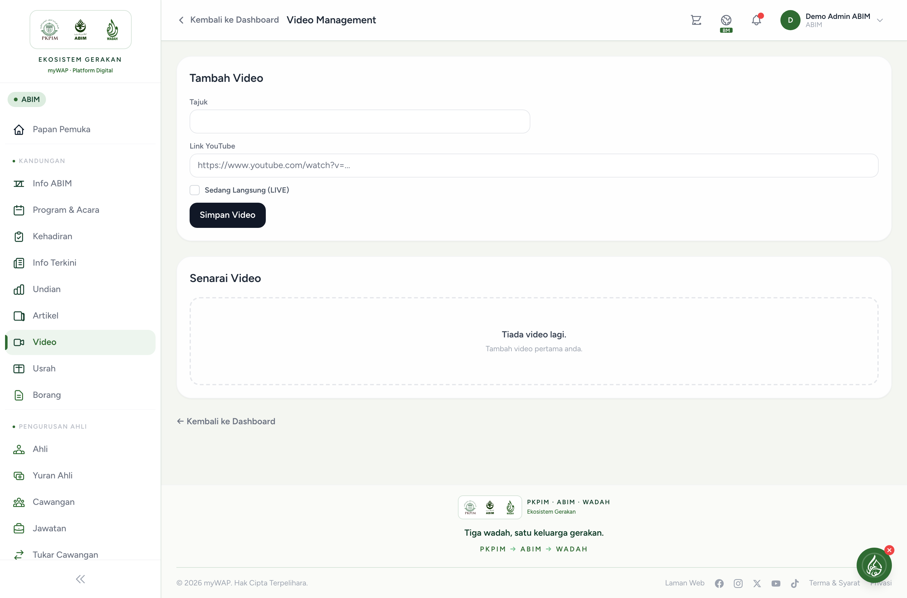

---

## 12. Popup

**Buka:** Sidebar → **Popup**

1. Tekan **Tambah Popup**.
2. Isi `Tajuk`, `Saiz Popup` (`Kecil`/`Sederhana`/`Besar`), `Kandungan`, `Imej Popup` (800×400).
3. Isi `Teks Butang 1` / `URL Butang 1`, dan `Butang 2` (pilihan).
4. Tetapkan `Display Order`, `Aktifkan popup`, `Mula`, `Tamat`.
5. Tekan **Simpan Popup**.

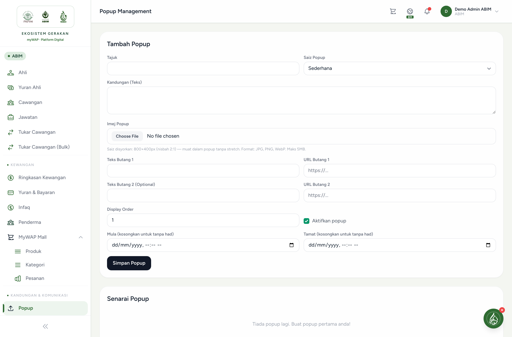

---

## 13. Infaq

**Buka:** Sidebar → **Infaq**

1. Tekan **Tambah Infaq Baru**.
2. Isi `Tajuk`, `Penerangan`, `Organisasi`, `Jenis Infaq` (`One-Off` / `Progress Bar`).
3. Isi `Pautan Bayaran Luar (DOKU)` kalau ada, `Benarkan donasi recurring`, `Sasaran (RM)`, `Susunan`, `Aktif`, `Gambar Infaq`.
4. Tekan **Tambah Infaq**.
5. Untuk kempen yang dah ada: `Kongsi` (QR + pautan), `Edit`, `Padam`, `Penderma`.

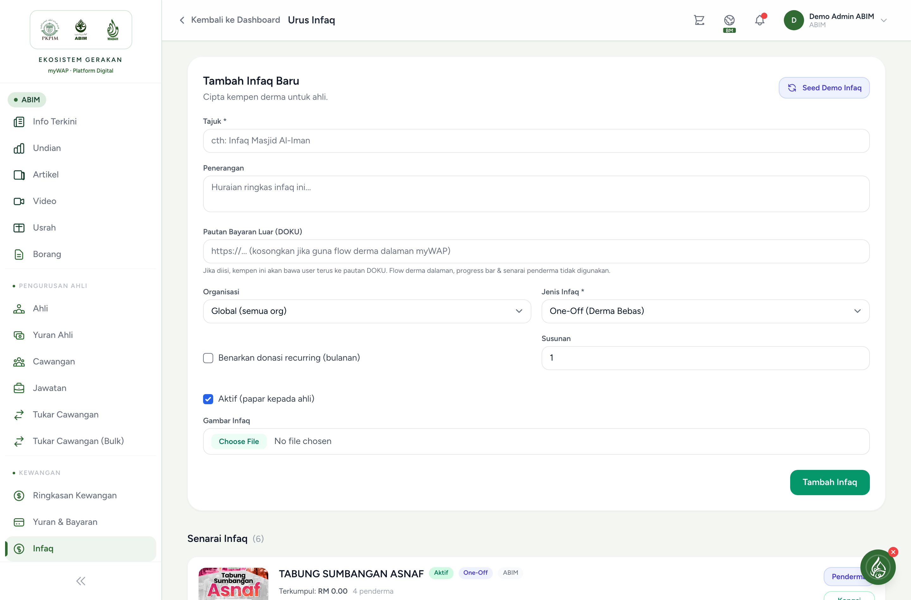

---

## 14. Penderma

**Buka:** Sidebar → **Penderma**

**Apa yang ada:**

- Ringkasan: `Penderma`, `Jumlah Sumbangan`, `Purata / Penderma`, `Jumlah Transaksi`.
- Search dan susunan (`Terkini`/`Tertinggi`/`Kerap`).
- Butiran penderma — profil, sejarah sumbangan, status.

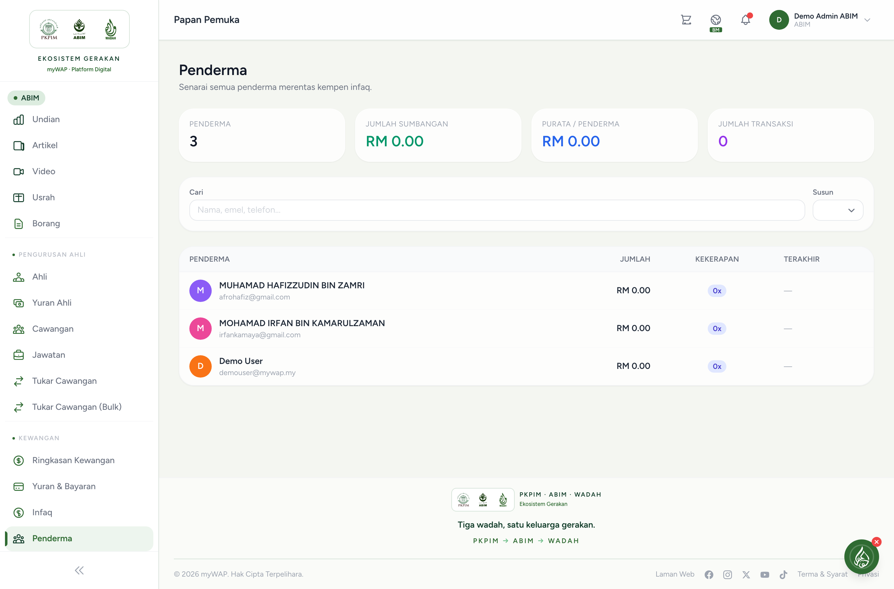

---

## 15. Borang (Form Builder)

**Buka:** Sidebar → **Borang**

**Langkah cipta borang:**

1. Tekan **+ Borang Baru**.
2. **Tetapan Borang** — Tajuk, Penerangan, Pertubuhan, Program (pilihan), Gambar Header, `Harga Asas (RM)`, `Wajib bayar`, `Harga Mengikut Kategori (Tier)`, Terma & Syarat, `Aktif`, `Boleh diakses awam`.
3. **Soalan** — tambah soalan (Teks, Perenggan, Nombor, Emel, Telefon, Tarikh, Dropdown, Radio, Checkbox, Muat Naik Fail, Negeri & Cawangan). Boleh susun dan tandakan `Wajib diisi`.
4. Tekan **Cipta Borang**.
5. Nak edar: `QR`, `Kongsi` (salin pautan), `Hantar` (emel), `Semua Ahli`.
6. Tengok `Respons` dan **Eksport CSV**.

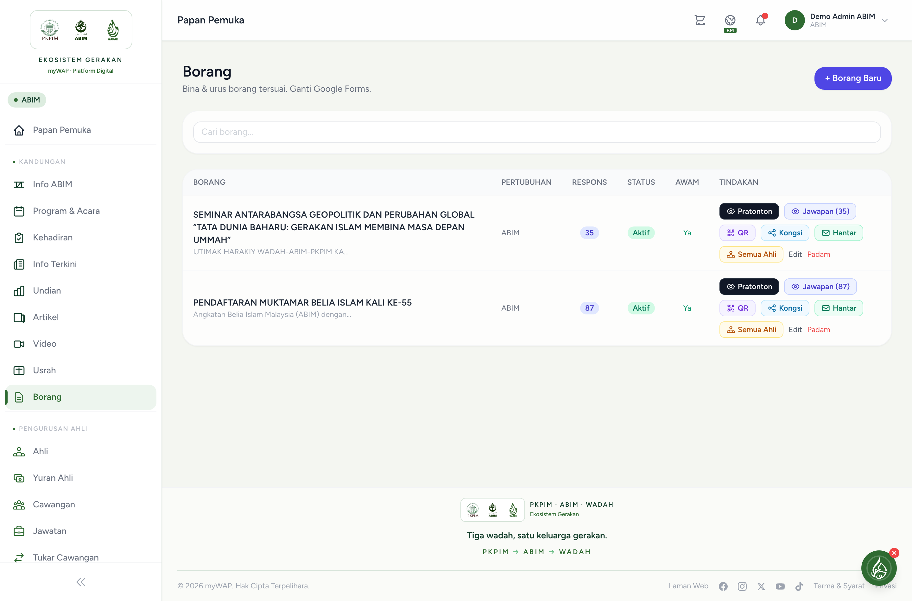

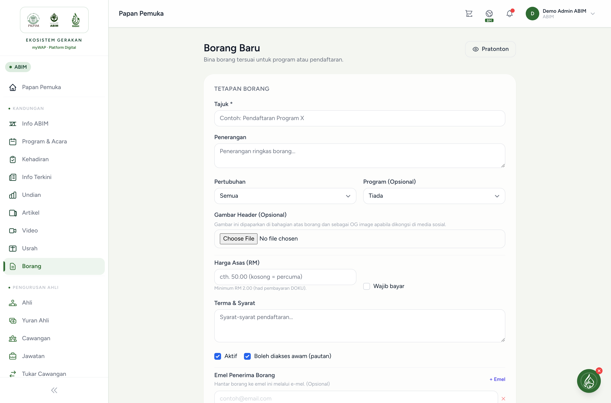

---

## 16. Undian & Tinjauan

**Buka:** Sidebar → **Undian**

**Langkah cipta:**

1. Tekan **Cipta Undian**.
2. Isi `Organisasi`, `Tajuk`, `Penerangan`, `Jenis` (`Poll`/`Survey`), `Tarikh Tamat`, `Sasaran` (`Semua Organisasi`, `Semua Ahli`, `Ahli Tertentu`, `Usrah Group`), `Tunjukkan keputusan`.
3. Tambah soalan (`Pilih Satu`/`Pilih Pelbagai`) dan pilihan jawapan.
4. Simpan.
5. Tengok `Keputusan` (kadar respons, peratusan), `QR`, `CSV`.

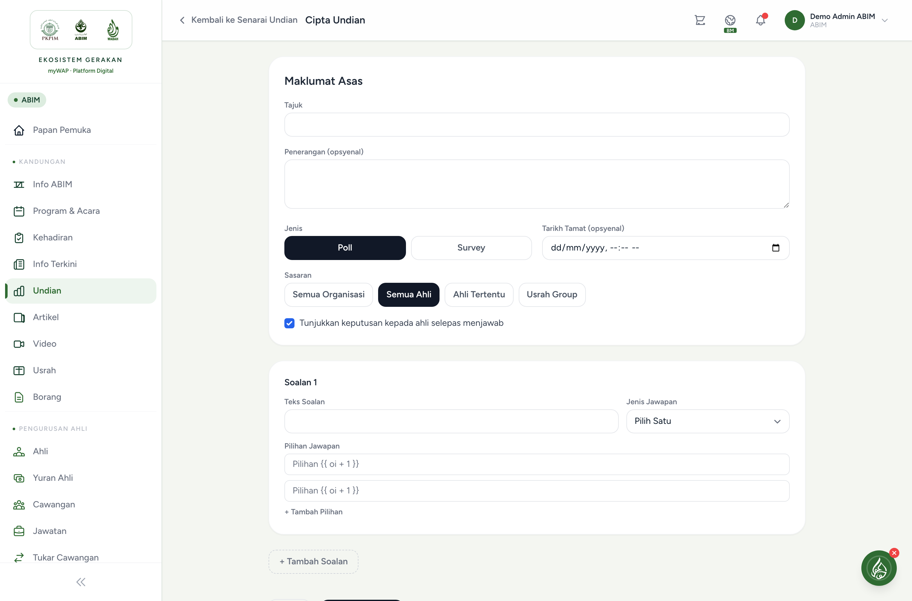

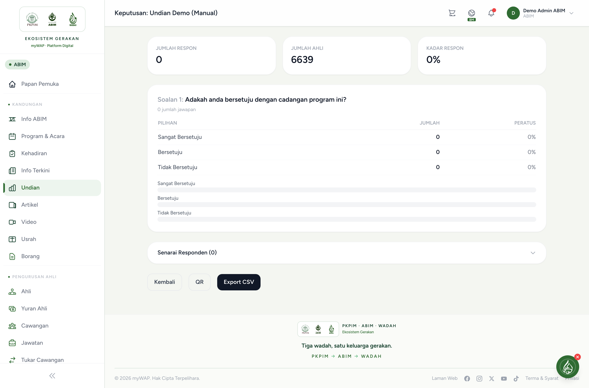

---

## 17. Kemudahan & Tempahan

**Buka:** Sidebar → **Urus Perkhidmatan/Fasiliti** dan **Senarai Tempahan**

### 17.1 Urus Fasiliti

1. Tekan **Tambah Perkhidmatan/Fasiliti**.
2. Isi Nama, Lokasi, `Jenis Tempahan` (`Hourly`/`Halfday`/`Daily`), `Harga Umum per Unit`, `Harga Ahli per Unit`, Kapasiti, `Aktif`, Deskripsi, `Imej Cover`, `Galeri`.
3. Tekan **Simpan Ruang**.

### 17.2 Senarai Tempahan

- Filter ikut status (`Pending`/`Approved`/`Rejected`).
- Tindakan: **Approve**, **Reject** (dengan catatan), **Tandakan Dibayar**.

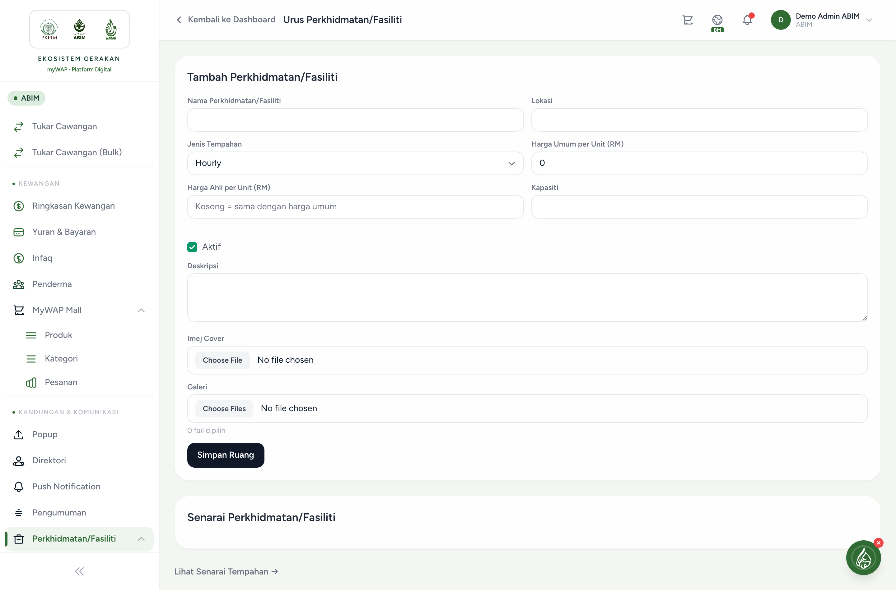

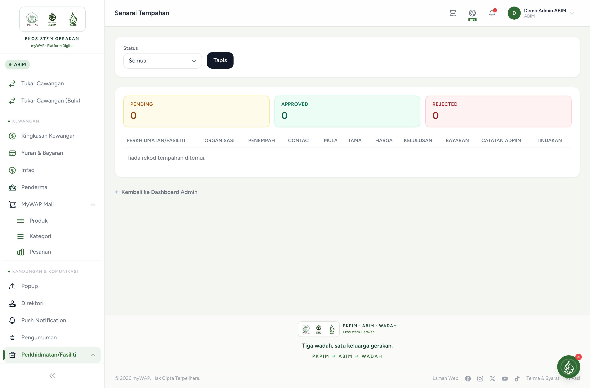

---

## 18. Usrah

**Buka:** Sidebar → **Usrah**

**Boleh buat:** Cipta kumpulan usrah (nama, penerangan, hari/masa pertemuan, `is_active`), edit, padam, dan **assign ahli** dengan role (`leader`/`sub_leader`/`member`).

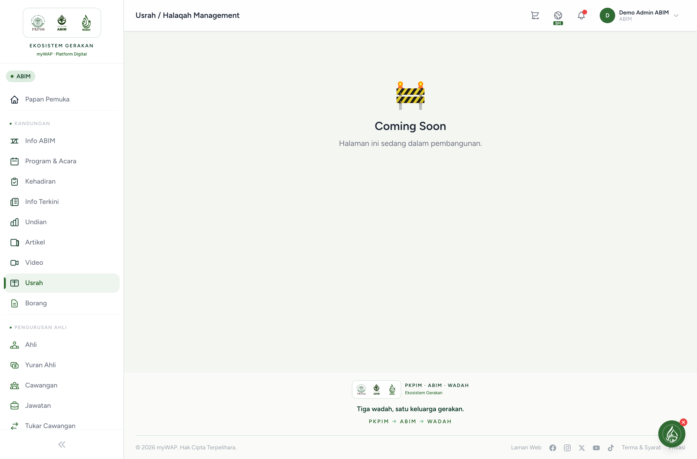

**Nota:** Halaman web untuk Usrah mungkin masih dalam pembangunan, tapi fungsi belakang tabir (cipta kumpulan, assign ahli) dah berfungsi.

---

## 19. Cawangan

**Buka:** Sidebar → **Cawangan**

1. Tekan **Tambah Cawangan**.
2. Isi `Nama Cawangan`, `Negeri`, `Telefon`, `Emel`, `Alamat`.
3. Simpan.
4. Pada kad cawangan: `Edit` (termasuk `Logo Cawangan`, `Cawangan Aktif`).
5. Urus **Admin Cawangan** — `Lantik Admin` hanya untuk ahli dalam cawangan tu.
6. Padam cawangan — cawangan yang ada ahli tak boleh dipadam.

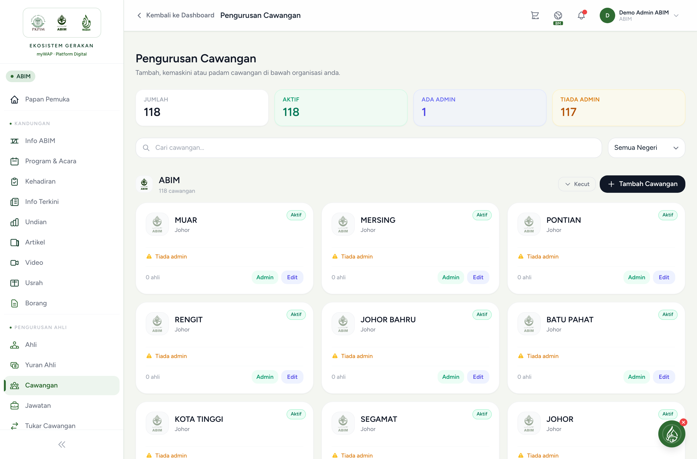

---

## 20. Jawatan

**Buka:** Sidebar → **Jawatan**

1. Tekan **Tambah Jawatan**.
2. Isi `Nama Jawatan`, `Kategori` (`Kepimpinan`, `Pentadbiran`, `Pengurusan`, `Teknikal`, `Keahlian`), `Deskripsi`, `Parent (Hierarki)`, `Turutan`, `Warna`.
3. Boleh susun (↑/↓), aktif/deactivate, edit dan padam.

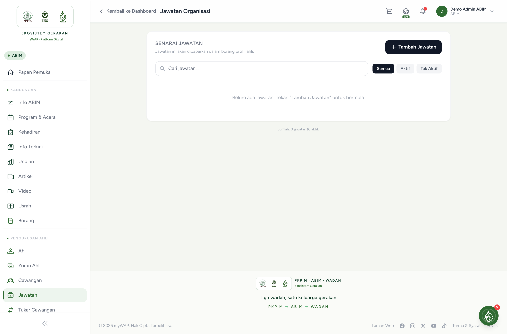

---

## 21. Pertukaran Cawangan

**Buka:** Sidebar → **Tukar Cawangan** dan **Tukar Cawangan (Bulk)**

### 21.1 Permohonan Pertukaran

- Senarai permohonan yang tunggu kelulusan.
- Tekan **Approve** untuk luluskan, atau **Reject** untuk tolak (kena bagi sebab).

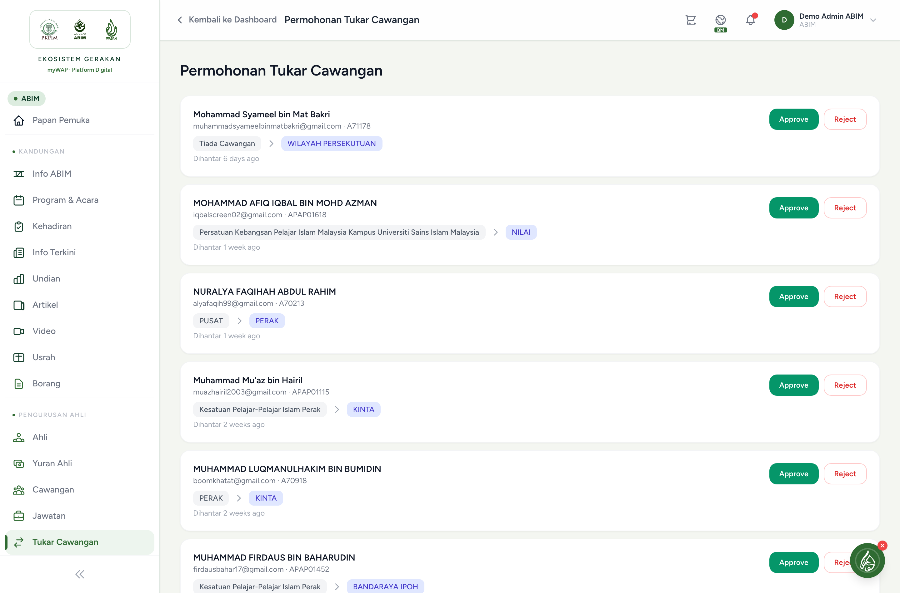

### 21.2 Tukar Cawangan Secara Pukal

1. Cari dan pilih ahli — boleh pilih banyak.
2. Pilih `Cawangan Sasaran`.
3. Tekan **Pratonton** dulu, lepas tu **Tukar N Ahli**.

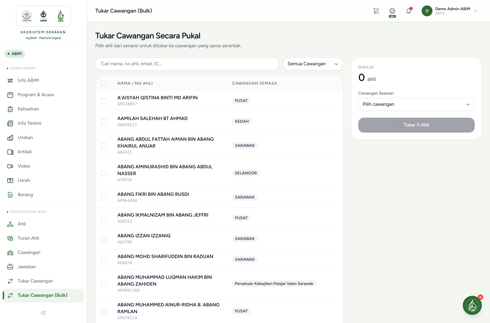

---

## 22. Kewangan

**Buka:** Sidebar → **Yuran & Bayaran** dan **Ringkasan Kewangan**

### 22.1 Yuran & Bayaran (Transaksi)

- Ringkasan `Jumlah Terkumpul`, `Menunggu Pengesahan`.
- Filter ikut status (`Berjaya`/`Menunggu`/`Gagal`/`Dipulangkan`) dan tarikh.
- **Eksport CSV**.
- **Nota:** Admin hanya pantau. Tukar status transaksi adalah fungsi Superadmin.

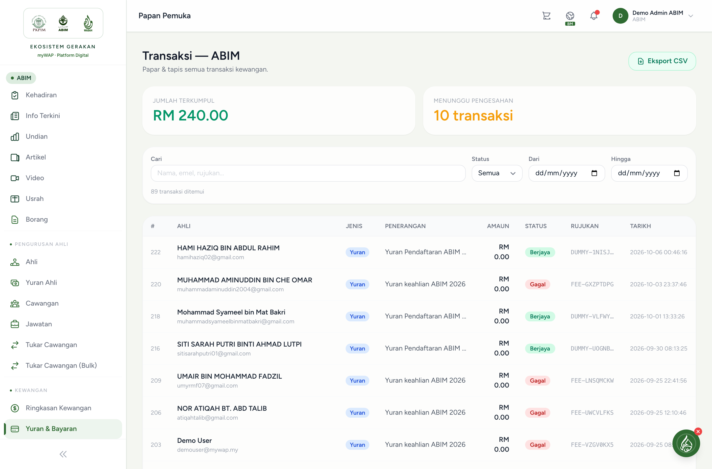

### 22.2 Ringkasan Kewangan

- Kad `Jumlah Pendapatan`, pecahan ikut sumber (`Yuran Keahlian`, `E-Commerce`, `Infaq`, `Kempen`).
- Carta `Pendapatan Bulanan` dan `Pecahan Mengikut Sumber`.
- Jadual transaksi. Tekan nama ahli untuk **Sejarah Transaksi**.
- Export: PDF / Excel / CSV.

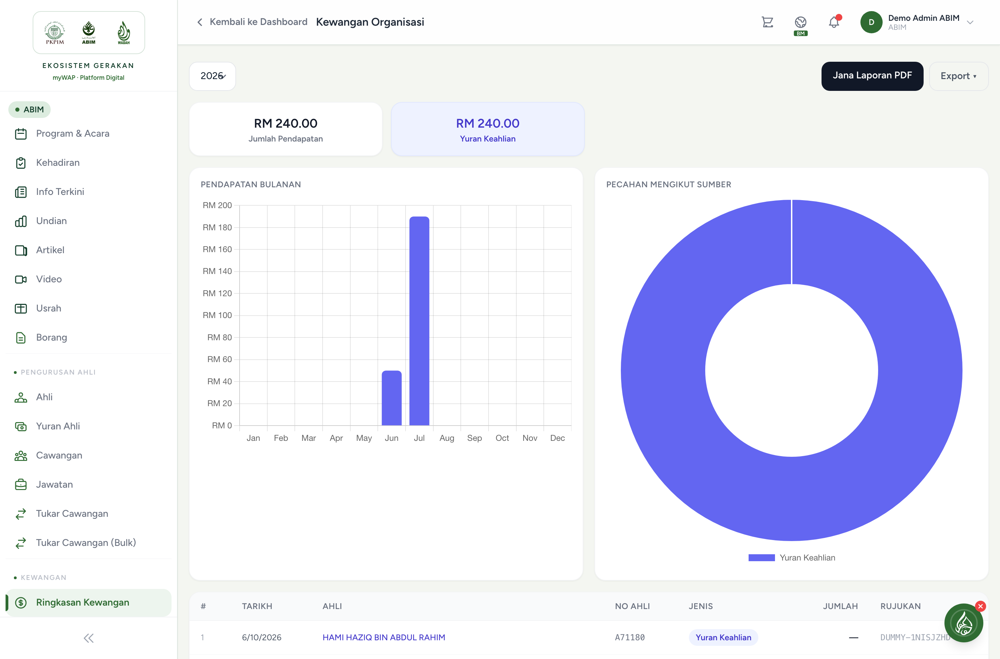

---

## 23. E-Dagang: Produk, Kategori, Pesanan

**Buka:** Sidebar → **Produk**, **Kategori**, **Pesanan**

- **Produk** — `Tambah Produk`, edit, harga ahli, stok, organisasi penjual. Kalau organisasi penjual takde, akan keluar amaran `TIADA ORG`.
- **Kategori** — tambah/edit kategori.
- **Pesanan** — lihat semua pesanan, kemas kini `Status` (`pending`/`paid`/`processing`/`shipped`/`completed`/`cancelled`) dan `Tracking No`, tekan **Kemaskini Status**.

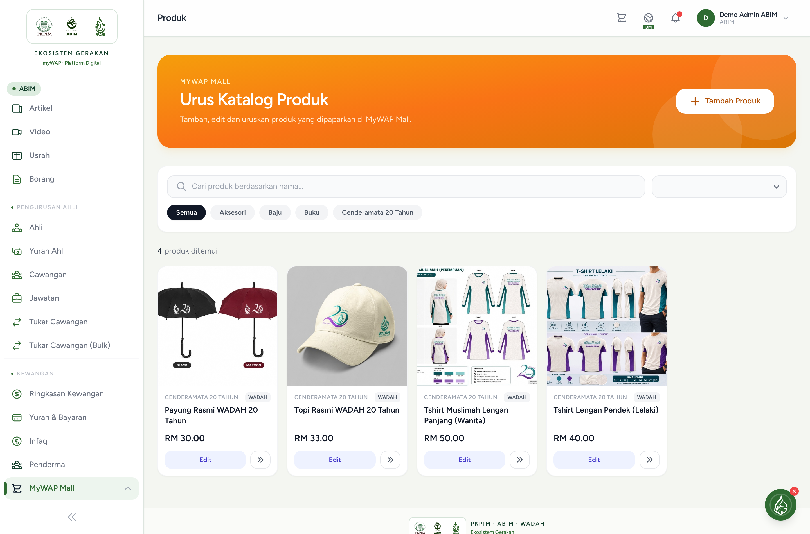

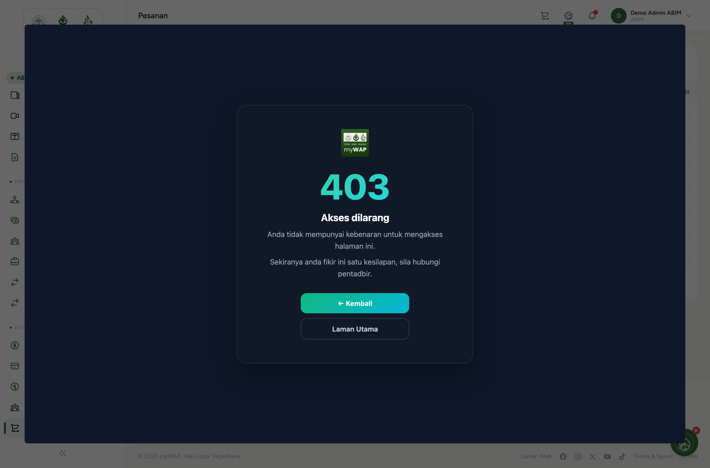

---

## 24. Direktori

**Buka:** Sidebar → **Direktori**

**Apa yang ada:** Cari ahli ikut nama, industri, kepakaran. Ada filter industri dan kad ahli dengan pautan LinkedIn. Hanya ahli yang benarkan paparan direktori akan muncul.

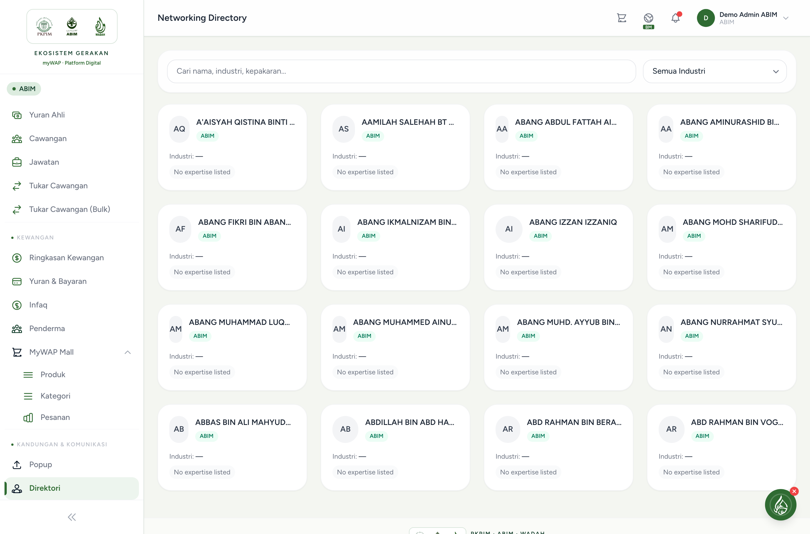

---

## 25. Info Organisasi & Carta

**Buka:** Sidebar → **Info Organisasi**

**Boleh buat:**

- **Maklumat** — kemas kini penerangan organisasi dan pautan media sosial.
- **Carta Organisasi** — `+ Tambah Ahli` (Gambar, Nama, Jawatan, Emel), edit dan padam.

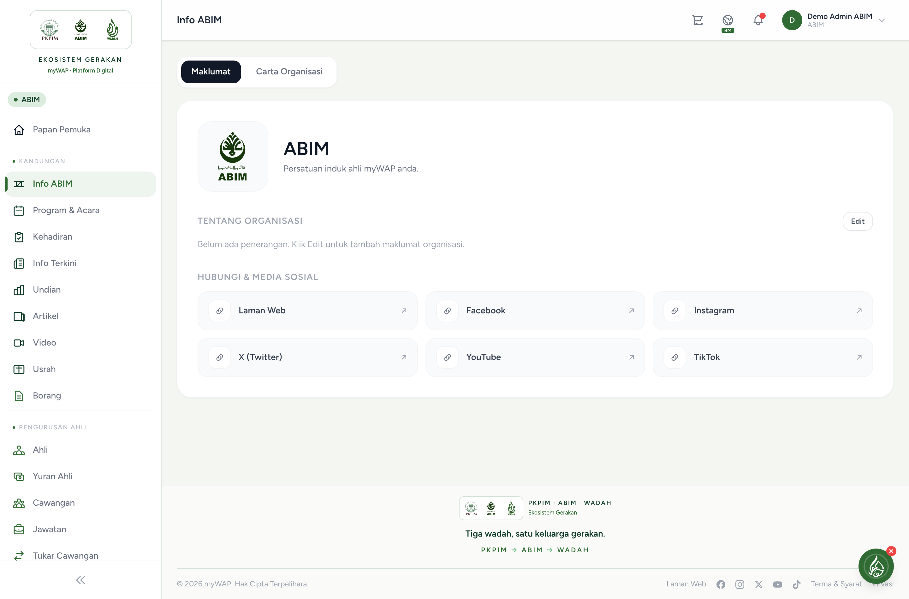

---

## 26. Export Data

**Buka:** Papan Pemuka → **Senarai Ahli Keseluruhan** → **Export**, dan **Jumlah Ahli Mengikut Negeri** → **Muat Turun Laporan**

- **Export Ahli (CSV)** — pilih jenis `Ringkas` atau `Penuh (Alamat)`.
- **Laporan Mengikut Negeri**.

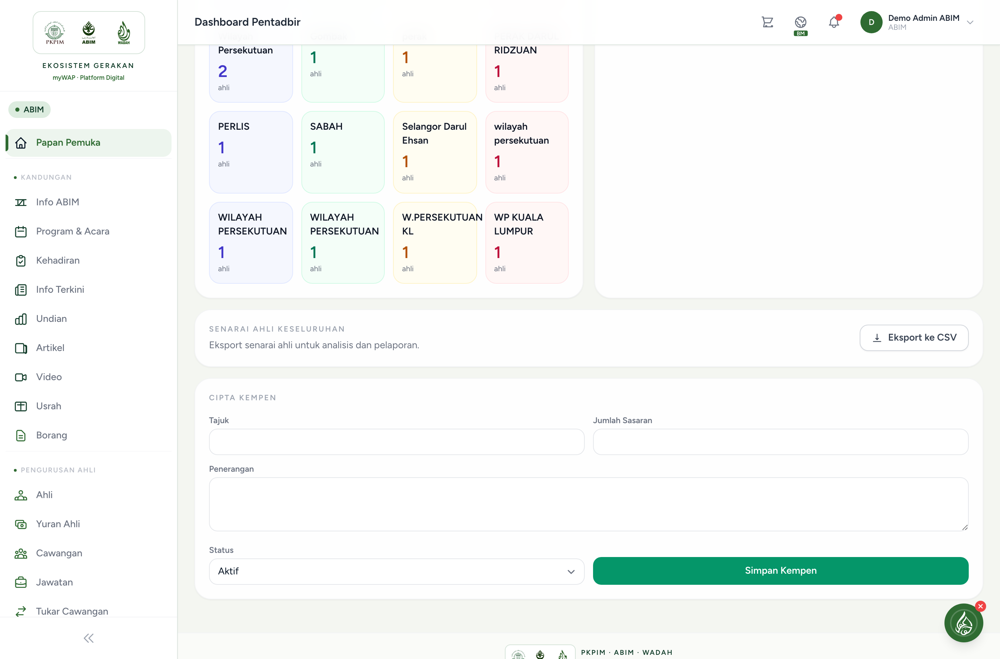

---

## 27. Soalan Lazim (FAQ)

**S: Kenapa saya tak nampak menu tertentu?**
J: Menu ikut role. Admin organisasi nampak menu organisasi sendiri sahaja. Fungsi peringkat platform (cth. tetapan sistem) hanya untuk Superadmin.

**S: Boleh tak saya tengok ahli organisasi lain?**
J: Tak boleh. Semua data terhad pada organisasi anda.

**S: Kenapa sesetengah butang tak boleh ditekan?**
J: Fungsi sensitif — tambah ahli, padam kekal, restore, import, reset kata laluan, update IC, tukar status transaksi — dibenarkan untuk ahli organisasi anda sendiri. Pindah ahli ke organisasi lain kekal Superadmin sahaja.

**S: Macam mana nak tambah ahli baharu?**
J: Tambah ahli baharu kerja Superadmin. Hubungi Superadmin. Admin organisasi cuma urus ahli yang dah ada.

**S: Macam mana nak padam ahli?**
J: Buang ke Tong Sampah boleh dari web (ikut role). Padam kekal — Superadmin.

**S: Macam mana ahli nak tukar cawangan?**
J: Ahli pilih cawangan baharu di Edit Profil. Permohonan tu masuk ke **Tukar Cawangan** untuk anda luluskan.

**S: Boleh tak saya hantar push notification kepada semua ahli?**
J: Boleh. Khalayak `Semua` akan terhad pada ahli organisasi anda sahaja.

**S: Kehadiran walk-in boleh direkod tak?**
J: Boleh — tekan `QR` pada kad program di halaman **Kehadiran**.

**S: Boleh export data ke Excel?**
J: Boleh. Ikut halaman — ada yang CSV, ada yang CSV / Excel / PDF. Contoh: Ahli → CSV, Yuran Ahli → CSV / Excel / PDF.

---

*Tamat Manual Admin Organisasi — myWAP.*
